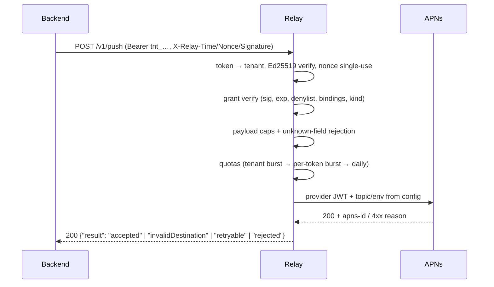

# How it works

## Architecture

```
                    ┌────────────────────────────────────────────┐
                    │                 your host                  │
 tenant backend ───►│ nginx (TLS, rate limit, /admin → 404)      │
   signed HTTP      │   └── uvicorn + FastAPI  (apns-relay)      │
                    │         ├── SQLite WAL (tenants, quotas,   │
                    │         │   nonces, challenges, denylist)  │
                    │         └── APNs sender (.p8 JWTs, http/2) │──► APNs
                    │                                            │
                    │ certbot (ACME, auto-renew)                 │
                    └────────────────────────────────────────────┘
```

- **nginx** terminates TLS, enforces coarse per-IP rate limits, and never
  proxies `/admin` to the app. `/docs`, `/redoc` and `/openapi.json` are
  proxied but served only by instances that opt in (`server.swagger_ui`).
- **The relay app** authenticates, authorizes, quotas, and forwards.
- **certbot** renews certificates on a timer; nginx reloads.
- **SQLite (WAL)** holds only blind material: token digests, HMAC'd
  destination indexes, single-use nonces, challenge hashes, denylist keys.

## Request flow: a push



Every push returns **HTTP 200** with a machine-readable `result`; structured
pre-flight failures (auth, grant, quota, payload) return their own status
codes with stable `error` strings. See the [API reference](api/openapi.md).

## The three push kinds

| `kind`         | APNs push type | Priority | Topic                             | Use                                       |
| -------------- | -------------- | -------- | --------------------------------- | ----------------------------------------- |
| `alert`        | `alert`        | 10       | bundle ID                         | User-visible notifications                |
| `background`   | `background`   | 5        | bundle ID                         | Silent refresh (`content-available: 1`)   |
| `liveActivity` | `liveactivity` | 5        | `bundleID.push-type.liveactivity` | Live Activity update/end (start deferred) |

Content is **keyed by kind** — you send exactly one section
(`content.alert`, `content.background`, or `content.liveActivity`) plus an
optional kind-independent `sealed` blob the relay treats as opaque bytes
(it is only size-checked, never decoded or logged).

## Enrollment in one paragraph

An app enrolls its device in three legs: `POST /v1/enroll/begin` sends a
**silent challenge push** to the device (proving the token is real and
reachable), `POST /v1/enroll/finish` proves the _app_ is genuine via
**Apple App Attest** and that the device received the challenge (assertion
over `SHA256(nonce ‖ serverChallenge)`), and the relay returns a
**destination-bound grant** plus a consent receipt. Renewal
(`POST /v1/enroll/renew`) re-signs a grant with fresh credentials — no new
attestation needed. Rotation (`POST /v1/rotate`) replaces a tenant's token
and signing key as a pair — authorized by a signature under the current
key — so paired devices re-enroll after a suspected key compromise.
Revocation (`POST /v1/revoke`) denylists the grant's `jti` immediately.

Full contract: [Enrollment spec v1.2](api/enrollment-spec.md).

## Why grants _and_ signatures?

A grant alone is not enough to push: `/v1/push` also requires the tenant
token and a valid per-request Ed25519 signature over the body. So a leaked
grant is useless without the tenant's credentials, and a leaked tenant token
is useless without its signing key. Both are checked, every request, with
±5-minute timestamp skew and single-use nonces against replays.
