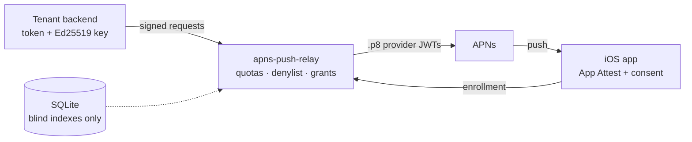

# apns-push-relay

**A generic, self-hostable web API that delivers APNs pushes on behalf of
your backends — without giving them your Apple keys, and without letting
anyone turn your relay into a spam cannon.**

Your backend holds one tenant token and a signing key; the relay holds the
`.p8` provider keys, verifies every request, enforces quotas, and forwards to
Apple. The relay never stores who your users are, what your payloads say, or
where their tokens came from.

## The four moving parts

- :material-shield-lock: **Privacy by design**
  No device table, no payload storage, no content in logs. Destination
  tokens exist only as keyed blind indexes. See [Privacy](privacy.md).

- :material-gavel: **Abuse controls**
  Per-minute and daily quotas, per-token rate limits, denylist, instant
  revocation, 30-day non-use deletion. See [Limits & abuse](limits-and-abuse.md).

- :material-key-variant: **Real enrollment**
  Destination-bound grants issued only after App Attest verification, a
  challenge push, and explicit in-app user consent.

- :material-server: **Yours to run**
  One `docker compose` up: nginx + certbot + relay. No hostnames, bundles
  or quotas are hardcoded — it is all `config.yaml`. See
  [Self-hosting](self-hosting.md).

## Trust panel

| The relay sees…                           | The relay never sees…                 |
| ----------------------------------------- | ------------------------------------- |
| Your tenant token **digest** + public key | Your signing private key              |
| Destination token **blind index** (HMAC)  | Who your users are, device tables     |
| Payload **sizes**, kinds, and results     | Payload content (sealed blobs opaque) |
| Route, status code, latency (logs)        | Tokens, grants, or content in logs    |

## Limits at a glance

| Limit                 | Default (per App, operator-set)          |
| --------------------- | ---------------------------------------- |
| Burst                 | `burst_per_min` per tenant               |
| Per-destination burst | `token_burst_per_min`                    |
| Daily                 | `daily` per tenant                       |
| Grant TTL             | `grant_ttl: min..max`, default `default` |
| Idle tenant deletion  | 30 days without use                      |

Check live numbers on the [Status](status.md) page.

## Three ways in

1. **I run my own backend** → [Getting started](getting-started.md):
   register, enroll your app's devices, push.
2. **I want to self-host the relay** → [Self-hosting](self-hosting.md):
   compose up in minutes, `relay doctor` validates everything.
3. **I want to understand it first** → [How it works](how-it-works.md):
   architecture, request flow, and the three push kinds.

---

MIT licensed · [Source](https://github.com/timlaing/apns-push-relay) ·
[Report abuse](https://github.com/timlaing/apns-push-relay/issues) ·
[Contact](https://github.com/timlaing/apns-push-relay/issues)
